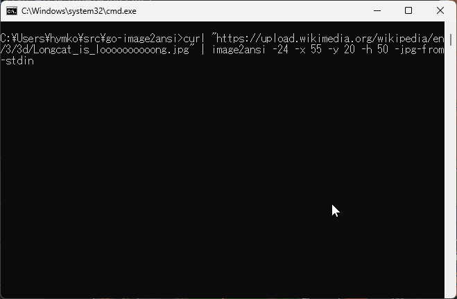

go-image2ansi
=============
( English / [Japanese](./README_ja.md) )

Display images as text in a terminal.



```
curl "https://upload.wikimedia.org/wikipedia/en/3/3d/Longcat_is_loooooooooong.jpg" | image2ansi -24 -x 55 -y 20 -h 50 -jpg-from-stdin
```

- Uses Unicode U+2580 ( &#x2580; ) and ANSI color sequences instead of Sixel Graphics. Each character cell represents two vertical pixels.
- Tested with Windows Terminal, Command Prompt, ConEmu,  WezTerm, and GNOME Terminal. In theory, it should work on any terminal that supports Unicode block characters and ANSI color sequences.

Install
-------

### Manual Installation

Download the binary package from [Releases](https://github.com/hymkor/go-image2ansi/releases) and extract the executable.

<!-- go run github.com/hymkor/example-into-readme/cmd/how2install@master | -->

### Use [eget] installer (cross-platform)

```sh
brew install eget        # Unix-like systems
# or
scoop install eget       # Windows

cd (YOUR-BIN-DIRECTORY)
eget hymkor/go-image2ansi
```

[eget]: https://github.com/zyedidia/eget

### Use [scoop]-installer (Windows only)

```
scoop install https://raw.githubusercontent.com/hymkor/go-image2ansi/master/image2ansi.json
```

or

```
scoop bucket add hymkor https://github.com/hymkor/scoop-bucket
scoop install image2ansi
```

[scoop]: https://scoop.sh/

### Use "go install" (requires Go toolchain)

```
go install github.com/hymkor/go-image2ansi/cmd/image2ansi@latest
```

Note: `go install` places the executable in `$HOME/go/bin` or `$GOPATH/bin`, so you need to add this directory to your `$PATH` to run `go-image2ansi`.
<!-- -->

## Usage

```text
image2ansi [options...] image-file...
```

### Options

- `-24`  
  Use 24-bit color with the following sequences:
  - `ESC[38;2;{r1};{g1};{b1}m`
  - `ESC[48;2;{r2};{g2};{b2}m`
  
  By default, 256 colors are used:
  - `ESC[38;5;{id1}m`
  - `ESC[48;5;{id2}m`
- `-gray`  
  Use 256-color grayscale.
- `-mono`  
  Use monochrome output with Unicode block characters ( U+2580: &#x2580; , U+2584: &#x2584; , U+2588: &#x2588; ) . No ANSI escape sequences.
- `-mono-reverse`  
  Reverse monochrome output for light backgrounds
- `-x X`  
  Image start X (0-based)
- `-y Y`  
  Image start Y (0-based)
- `-w WIDTH`  
  Specify the output width.
  By default, the current terminal width is used. When output is redirected, no width limit is applied, and the original image width is used.
- `-h HEIGHT`  
  Specify the output height.
- `-gif-from-stdin`  
  Read a GIF image from standard input
- `-jpg-from-stdin`  
  Read a JPEG image from standard input
- `-png-from-stdin`  
  Read a PNG image from standard input
- `-qr string`  
  Display the given string as a QR code

### Supported Image Formats

- GIF
- PNG
- JPEG
- BMP
- ICO

## Using with the text pager, [nemo]

When the image is too large to fit in the terminal, you can
pipe the output to [nemo]
to scroll both horizontally and vertically without wrapping lines.

```sh
image2ansi image.png | nemo
```

[nemo]: https://github.com/hymkor/nemo
