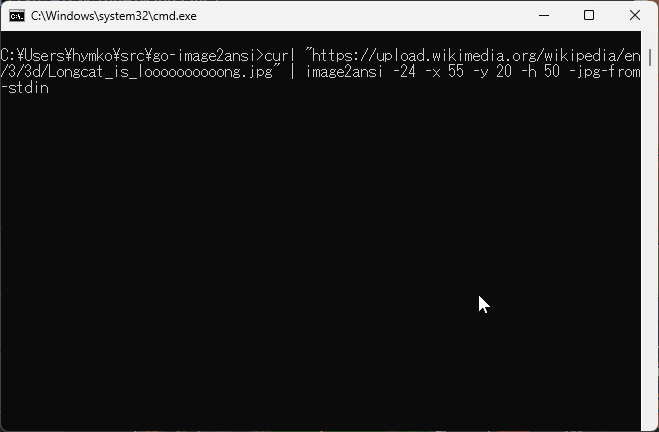

go-image2ansi
=============
( [English](README.md) / Japanese )

指定した画像をターミナルにテキストとして出力します。



```
curl "https://upload.wikimedia.org/wikipedia/en/3/3d/Longcat_is_loooooooooong.jpg" | image2ansi -24 -x 55 -y 20 -h 50 -jpg-from-stdin
```

- Sixel Graphics を使わず、Unicode の U+2580 ( &#x2580; ) と ANSIカラーシーケンスを用いて、テキストの１キャラクターに２ピクセルを表示させます。
- Windows Terminal, Command Prompt, ConEmu, WezTerm, GNOME Terminal で動作確認しています。Unicode のブロック文字と、ANSI カラーシーケンスをサポートする端末であれば、理論上動作します。

Install
-------

### Manual Installation

[Releases](https://github.com/hymkor/go-image2ansi/releases) よりバイナリパッケージをダウンロードして、実行ファイルを展開してください

<!-- go run github.com/hymkor/example-into-readme/cmd/how2install@master ja | -->

### [eget] インストーラーを使う場合 (クロスプラットフォーム)

```sh
brew install eget        # Unix-like systems
# or
scoop install eget       # Windows

cd (YOUR-BIN-DIRECTORY)
eget hymkor/go-image2ansi
```

[eget]: https://github.com/zyedidia/eget

### [scoop] インストーラーを使う場合 (Windowsのみ)

```
scoop install https://raw.githubusercontent.com/hymkor/go-image2ansi/master/go-image2ansi.json
```

もしくは

```
scoop bucket add hymkor https://github.com/hymkor/scoop-bucket
scoop install image2ansi
```

[scoop]: https://scoop.sh/

### "go install" を使う場合 (要Go言語開発環境)

```
go install github.com/hymkor/go-image2ansi/cmd/image2ansi@latest
```

`go install` は `$HOME/go/bin` もしくは `$GOPATH/bin` へ実行ファイルを導入するので、`image2ansi` を実行するにはそのディレクトリを `$PATH` に追加する必要があります。

<!-- -->

Usage
-----

```
image2ansi {オプション...} 画像ファイル名...
```

### オプション

- `-24` シーケンス `ESC[38;2;{r1};{g1};{b1}m` `ESC[48;2;{r2};{g2};{b2}m`を使って、
   24bit color で出力します。
   省略時は `ESC[38;5;{id1}m` `ESC[48;5;{id2}m`を使って 256色で出力します。
- `-x X`  
        表示開始X座標 (0-based)
- `-y Y`  
        表示開始Y座標 (0-based)
- `-w WIDTH` 出力する幅を指定します。
   省略時は現在のターミナルの桁数を使用します。
   リダイレクトされている時は幅を制限せず、画像そのものの横幅をそのまま使用します。
- `-h HEIGHT` 出力する行数指定します。
- `-gif-from-stdin` 標準入力から GIF 画像を読み込みます。
- `-jpg-from-stdin` 標準入力から JPEG 画像を読み込みます。
- `-png-from-stdin` 標準入力から PNG 画像を読み込みます。

### 画像ファイル名

.GIF、.PNG、.JPG(.JPEG) が利用可能です。
